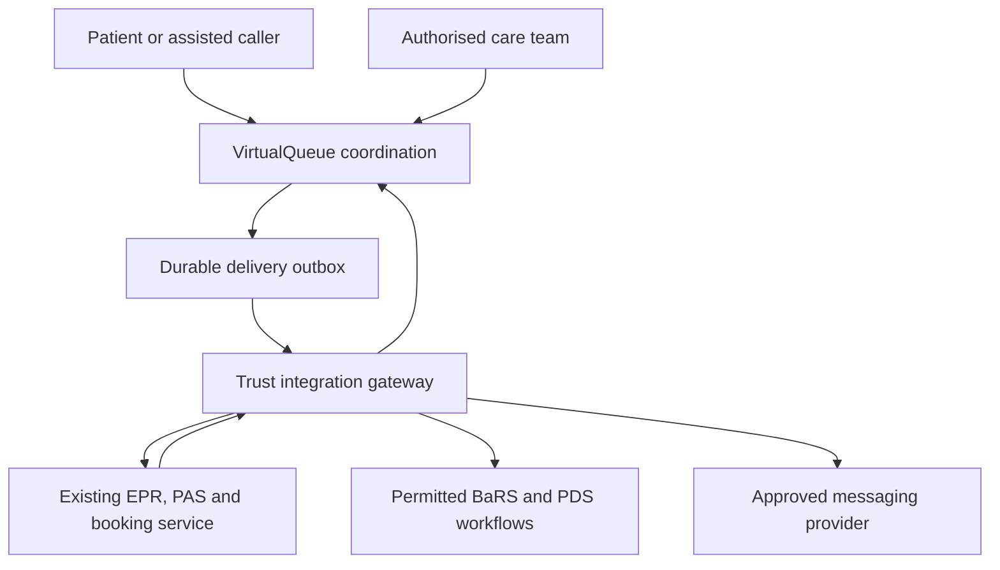

# NHS VirtualQueue

**Clinically supervised remote waiting and hospital arrival coordination.**

Created and maintained by **A Haque (zaid)**. Independent open source software under [Apache License 2.0](LICENSE), with optional [paid implementation, integration, hosting and support](COMMERCIAL.md). This is not an official NHS service and is not connected to live NHS systems.

NHS VirtualQueue brings callback requests, clinician assessment, receiving-service booking confirmation, travel planning and patient follow-up into one application. It is designed to work alongside a hospital's existing electronic patient record (EPR), patient administration system (PAS) and booking arrangements.

The purpose is to help suitable patients spend less of their wait in a hospital waiting room. It does not create clinical capacity, guarantee faster treatment or let people reserve an unassessed place in A&E. Clinical urgency determines who is seen first. Arriving by ambulance alone does not give a person automatic priority.

## What works in this release

| Area | Implemented behaviour |
| --- | --- |
| Patient access | Telephone verification, reopening a visit with its reference, own-visit status and clinical instructions |
| Care team | Organisation-scoped workspace, assisted requests, clinician assessment, arrival and care records |
| Remote waiting | Requires a clinician's decision and an accepted receiving-service booking; local reservation alone is insufficient |
| Travel | Journey time, arrival buffer and departure reminder; optional Google Routes estimate with location permission |
| Queue information | Approximate number ahead among registered visits in the care stream, withdrawn when data or clinical permission expires |
| Safety follow-up | Worsening symptoms, overdue review, missed arrival, stale capacity and uncertain messages produce follow-up states; no automatic discharge |
| Delivery | Durable outbox, stable idempotency keys, explicit unknown outcomes and reconciliation endpoints |
| Patient matching | DOB, family name and postcode; read-only PDS candidate client; integration-only record-link endpoint |
| Accountability | Version checks, protected clinical history and a verifiable HMAC audit chain |
| Operations | Migrations, PostgreSQL support, non-root container, CI checks and deployment template |

This is runnable application code with automated tests. **It is not authorised for clinical deployment.** Live onboarding, an approved trust gateway, receiving-system mapping, clinical safety work and deployment assurance remain outstanding. See [release evidence](docs/validation.md) for exactly what has been tested.

## Run locally

You can run and evaluate the code under Apache 2.0 without a licence fee or a service contract. The local workflow below uses synthetic data. Clinical deployment still needs the approvals and integration work described in this README.

Requires Python 3.12 or later. Run from a checkout:

```bash
python -m venv .venv
source .venv/bin/activate
python -m pip install -r requirements.lock
python -m pip install -e '.[test]'
virtualqueue keys
alembic upgrade head
virtualqueue local
```

Open <http://127.0.0.1:8000>. `/patient` opens patient access and `/staff` opens the care team workspace. Local mode creates a labelled synthetic service, shows verification codes on screen and simulates external delivery. Use invented information only. Development sign-in and synthetic seeding are disabled in production.

To exercise a complete journey:

1. Open `/patient`, enter an invented name, DOB, postcode and international-format telephone number, then verify the displayed test code.
2. Open `/staff` in a separate browser profile. Select the local clinician role and start the assessment.
3. Record the assessment, clinical instructions, review deadline, latest safe attendance and an available arrival window. Remote waiting is restricted to clinician-assigned priority 3–5 and still needs a clinical suitability decision.
4. The worker processes the simulated hospital booking. The patient sees an arrival window after acceptance.
5. Report worsening symptoms or record arrival and care. Inspect the follow-up state, delivery records and audit history.

Use separate profiles because browser cookies represent one signed-in role. The development capacity feed is synthetic, not hospital availability.

## Integration with existing services



The trust remains responsible for clinical records, triage, identity verification and available capacity. The BaRS and PDS clients are transport boundaries for an approved integration, not claims of NHS conformance or access. There is no universal national real-time A&E queue API in this project. The participating service must supply current capacity and reconcile its clinical arrivals.

DOB and postcode help trace a record; they are not passwords or proof of ownership. A telephone code proves control of that number at that time, not NHS identity. PDS candidate matches need the trust's identity-checking workflow. Uncertain, restricted or mismatched records require manual handling. People without a match or usable telephone/postcode must retain access through existing care routes.

## Security and clinical boundaries

Production mode requires PostgreSQL, HTTPS, OIDC, a mutual-TLS gateway and a clinical release reference. Staff roles come from the trusted identity provider. Patients cannot choose roles, read other visits or assign clinical priority. Health information and credentials do not belong in logs, analytics or public issues.

Encryption protects selected database fields; authorised staff still need appropriate access. The audit chain detects alteration while its keys and trusted checkpoint remain secure. It is not independently immutable storage. Deploying organisations must manage external checkpoints, backups, key rotation, access reviews and monitoring.

There is no autonomous diagnosis or AI triage. The application records a clinician's decision; it cannot decide that someone is safe at home. It must not delay 999, NHS 111 or in-person assessment. Clinical corrections and cancellations add records rather than erasing earlier events.

## Verification and deployment

```bash
ruff check .
pytest --cov=virtualqueue --cov-report=term-missing
pip-audit -r requirements.lock
```

CI is configured for SQLite and disposable PostgreSQL. Browser checks and actual results are recorded in [validation](docs/validation.md). No live patient data is used.

The [deployment template](deploy/compose.yaml) separates API, worker and migrations. It expects an external PostgreSQL service, organisation-controlled identity provider and trust gateway. It is a deployment configuration, not a pre-approved NHS hosting environment.

## Documentation

* [NHS integration and identity](docs/nhs-integration.md)
* [Gateway and delivery contract](docs/gateway-contract.md)
* [Clinical intended use](docs/clinical-safety.md) and [hazard register](docs/hazards.csv)
* [Security and operations](docs/operations.md)
* [NHS Innovation Service brief](docs/innovation-submission.md)
* [Validation evidence](docs/validation.md) and [API specification](docs/openapi.json)
* [Contributing](CONTRIBUTING.md) and [security reporting](SECURITY.md)
* [Paid services and revenue model](COMMERCIAL.md) and [copyright and dependency notices](NOTICE)

## Licence

Copyright 2026 A Haque (zaid). This release is open source under [Apache License 2.0](LICENSE). You may use, modify and redistribute the software, including commercially, under that licence. Retain the required licence, copyright and attribution notices and identify modified files as required by the licence. Third-party dependencies retain their own licences; see [NOTICE](NOTICE).

The proposed business model is paid implementation and integration work, with optional recurring hosting, maintenance and support contracts. NHS organisations and other customers can request a quote for those services. Pricing, availability, responsibilities and service levels must be agreed in writing. The open source licence does not include free services or a support commitment.

Customers may self-host or use another provider without paying the maintainer a software licence fee. A service contract does not limit their Apache 2.0 rights. The licence does not grant permission to use NHS branding or establish clinical approval. [Discuss paid services](https://github.com/zaid3/NHS-VirtualQueue/issues/new?template=commercial-licensing.md).

